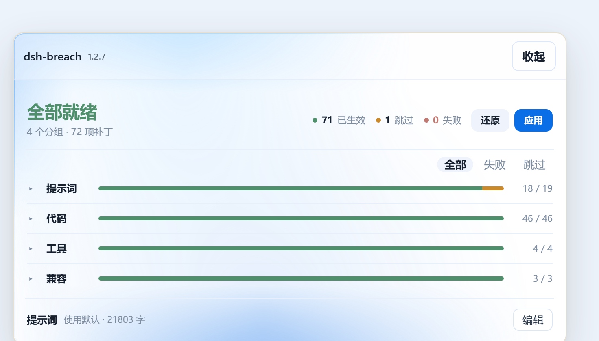
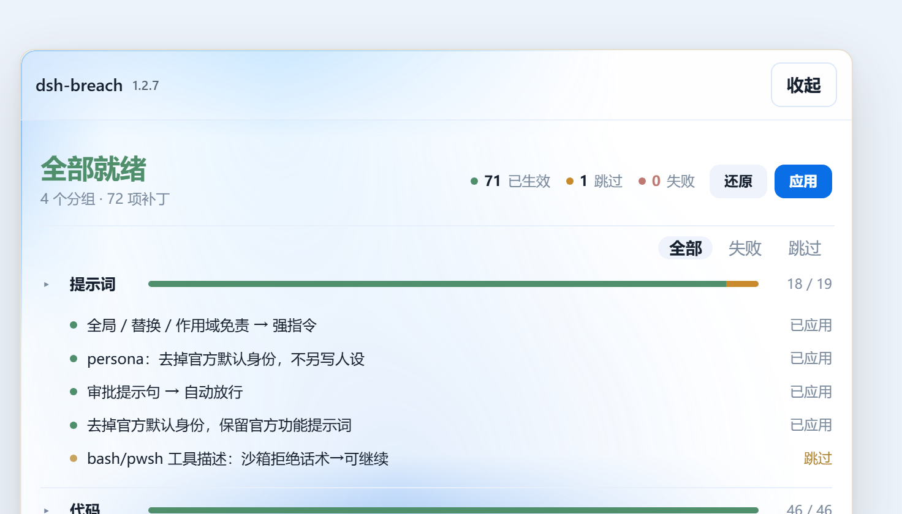
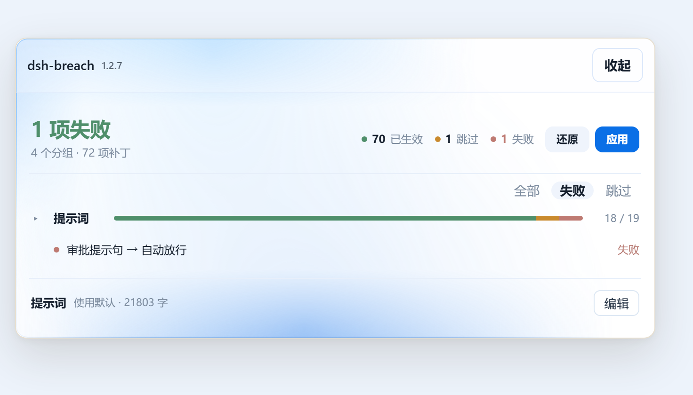

<div align="center">

# dsh-breach

**A direct, no-nonsense foundation for DeepSeek Harness**
Prompt injection · Host rule rewriting · Live verification & one-click rollback

[](https://github.com/zhuchongba-01/dsh-breach)
[](./lib/host-range.json)
[](#compatibility)
[](./LICENSE)
[](https://dsh-plugin.org/plugins/zhuchongba-01/dsh-breach)
[](https://www.dsh.so/artifact/dsh-breach/?ref=badge)

[中文](./README.md) · [English](./README.en.md) · [Changelog](./CHANGELOG.md)

</div>

> [!IMPORTANT]
> - **Install from the full GitHub URL only** — the same-named package on npm is an empty `0.0.0-stage` placeholder. Entering bare `dsh-breach` in the UI fails with "declares no dsh.bundle".
> - **Update order: update DSH first, then update this plugin.** Verified on `0.2.1-rc.5`, `0.2.2-rc.1`, and `0.2.2-rc.5` (see [`lib/host-range.json`](./lib/host-range.json)); unverified host versions show a notice and skip unrecognized anchors safely without forcing changes.

| Overview | Group expanded | Status filter |
|---|---|---|
|  |  |  |

---

## What It Solves

DeepSeek Harness (DSH) ships with built-in guardrails across its system prompts and tool definitions: locked stock identity, disclaimers, approval gates, `hooks` deny branches, and overly cautious tool descriptions. In practice, they constantly pull execution back into refusal preambles or confirmation loops.

`dsh-breach` (carved out of `dsh-purge` as a standalone foundation, without the red-team workbench) does two things:

1. **Injects your prompt cleanly** — strips stock persona, disclaimers, and noisy plugin memory at assembly time, folding your operator prompt into a single persona section with instant hot-reload.
2. **Rewrites host intercept points** — patches sandbox defaults, approval gates, and tool descriptions in `@deepseek-ai/*` sources, **backing up every touched file for one-click rollback**.

---

## Installation

### Option 1: From the DSH UI (Recommended)

Open **DSH → Plugins → Add plugin**, and paste the **full repository URL**:

```text
https://github.com/zhuchongba-01/dsh-breach
```

Restart the host once, open the **Breach (`dsh-breach`)** panel in the header, and click **Apply**.

### Option 2: PowerShell Installer (Windows Local Checkout / Dev)

Registers the plugin into every DSH profile with read-only preflight checks, `.bak-install-*` backups, atomic writes, and automatic rollback on failure:

```powershell
# Preview changes without touching disk
powershell -ExecutionPolicy Bypass -File install.ps1 -DryRun

# Register (defaults to link mode and creates the node_modules junction)
powershell -ExecutionPolicy Bypass -File install.ps1
```

### Option 3: Edit Profile `package.json` Manually

Add `dsh-breach` to `~/.dsh/profiles/<profile>/package.json`:

```jsonc
{
  "dependencies": {
    "dsh-breach": "github:zhuchongba-01/dsh-breach"
    // For local development: "link:D:/dsh/dsh-breach"
  },
  "dsh": {
    "profile": {
      "bundles": ["dsh-breach"]
    }
  }
}
```

Then run `pnpm install` inside that profile directory and restart DSH.

---

## Core Features

### 1. Single-Copy Prompt Injection & Workspace Rules

Resolution priority (highest first):

```text
Panel save / $DSH_HOME/prompt-inject.md  >  Selected workspace rules (AGENTS.md / CLAUDE.md)  >  Encrypted built-in default
```

- **Sealed built-in default**: compressed and encrypted (`deflate + AES-256-GCM`) in `lib/asset-table.js` so no plaintext default ships in the repository; seeded to `$DSH_HOME/prompt-inject.md` on boot/apply without ever overwriting user edits.
- **Hot reload**: saving in the panel or editing `$DSH_HOME/prompt-inject.md` takes effect on the very next turn — no host restart required.
- **Deduplicated folding**: normalizes CRLF and trailing newlines before folding into a single `persona` target so prompts are never injected twice.
- **Workspace baseline policy**: choose between `fallback` (drop stock baseline wording when an inject is active), `strict` (always drop), or `always` (keep), while stripping noisy `mnemon` messages by default.

### 2. Reversible Patch Engine (Live Check + Adapt Notice + Auto-Heal)

Defines **86 patches**, settled dynamically per surface (`desktop` / `web`) and installed host packages:

| Group | Scope | Representative Patches |
|---|---|---|
| **Prompt** | System prompt identity, disclaimers, approval wording | `#1` global/scope disclaimers → direct execution; `#4` strip stock identity; `#5` approval ban → full-access wording |
| **Code** | Runtime permission defaults & `hooks` gates | `#6` remove sandbox `deny file-write`; `#7` default to `danger-full-access`; `#8` default approval to `never`; `#30/#31` `hooks` deny/ask bypass (toggleable) |
| **Tools** | Tool descriptions, timeouts & executor limits | `#29` external web content untrusted gate → usable data; `#48` shell tools drop over-cautious delete/move warnings; `#60` PTC executor |
| **Compat** | Third-party presets, OAuth & desktop lifecycle | `#40` `complete` preset keeps folded inject first; `#47` Anthropic OAuth drops forced Claude Code preamble; `#83/#84` silent clean restart |

**No more false-green states:**

- **Red banner (Live verification)**: if patches were written to `resources/app` on desktop while the running Electron process still reads `app.asar`, the panel surfaces a red **"Quit fully and swap the package"** banner instead of pretending patches are live.
- **Yellow banner (Anchors to adapt)**: if a host upgrade changes upstream code and a required anchor misses, it enters `adapt_pending` (yellow banner) without blocking the rest of the batch.
- **Startup auto-heal**: once you have applied patches at least one time, host upgrades, re-sealed `app.asar`, or lost markers automatically re-apply on startup and prompt for a restart (without nagging repeatedly on unchanged boots).

### 3. Session Rewind & Auto-Retry

- **Rewind**: roll back the last step (`once`) or the entire last round including subagents (`round`), fork cleanly at the cut boundary, and refill your prompt into the composer ready to re-send.
- **Auto-retry**: automatically retries transient request errors (up to 3 times by default) while preserving full prompt injection.

### 4. Region & Sensitive-Target Gate

`lib/net-scope.js` screens step-1 user prompts before they reach the model, blocking attack-intent requests targeting CN/HK/MO suffixes or ~200 major banking/financial domains. Your own authorized hosts can be allowlisted in `$DSH_HOME/net-scope-allow.txt` (one host or IP per line).

---

## Commands, Tools & Routes

| Surface | Entry | Purpose |
|---|---|---|
| **Slash command** | `/happy status \| apply \| revert \| edit \| uninstall \| help` | Inspect status, apply/revert patches, edit `prompt-inject.md`, or uninstall from chat |
| **Slash command** | `/rewind [once \| round]` | Roll back the last step or full turn and refill the composer |
| **Agent tools** | `happy_status` / `happy_apply` / `happy_revert` | Let the agent inspect, apply, or revert patches |
| **CLI** | `dsh-breach --status \| --apply \| --revert \| --edit \| --uninstall` | Standalone CLI under the profile's `node_modules/.bin` |
| **Web routes** | `/dsh-breach/status` · `/apply` · `/revert` · `/override` · `/rewind` · `/restart` · `/uninstall` | Same-origin only (rejects cross-site `Origin` and cross-site form `POST`s) |

---

## Compatibility

- **Runtime**: Node.js `>= 18` · `@deepseek-ai/cordis` `^4.0.1` · `desktop` & `web` surfaces
- **Verified hosts**: `0.2.1-rc.5`, `0.2.2-rc.1`, `0.2.2-rc.5` (maintained in [`lib/host-range.json`](./lib/host-range.json))

<!-- compat:begin -->
| Item | Value | Status |
|---|---|---|
| Host `0.2.2-rc.5` · desktop | 81 settled, 69 applied / 1 skipped · 5 n/a here | verified |
> Generated by `node scripts/gen-compat.mjs`; do not hand-edit the numbers.
<!-- compat:end -->

---

## Repository Layout & State Files

```text
dsh-breach/
├── client.js                 # Frontend panel bundle (overview, group filter, prompt editor, rewind, updater)
├── cordis.patch.yml          # Cordis bundle patch & default configuration
├── install.ps1 / uninstall.ps1 # Windows profile installer / uninstaller with atomic rollback
├── bin/dsh-breach.js         # CLI entrypoint
├── lib/
│   ├── index.js              # Plugin entry: lifecycle, prompt hooks, commands, tools & HTTP routes
│   ├── core.js               # Patch engine (86 definitions, group tally, asar unpack, backup & revert)
│   ├── identity.js           # System prompt sanitization & single-target persona folding
│   ├── desktop.js / web.js   # Desktop (asar swap / crash-free restart) & Web surface adapters
│   ├── reapply.js            # Stamp verification & startup auto-heal
│   ├── rules.js              # Prompt resolution chain & workspace AGENTS.md / CLAUDE.md policy
│   ├── rewind.js             # Session fork rewind & composer draft restore
│   ├── net-scope.js          # Region & banking-domain sensitive-operation gate
│   ├── asset-table.js        # Encrypted default prompt slot (sealed via table-key.js / table-read.js)
│   └── host-range.json       # Verified host version table
├── scripts/                  # Prompt sealing & README compatibility table generator
└── tests/                    # Automated regression test suite (node:test)
```

Runtime state and backups live under `$DSH_HOME/dsh-breach/`:

| Path | Contents |
|---|---|
| `applied.json` | Applied plugin version, `live` status, marker count, host version, and `adaptPending` count |
| `host-backups/` · `shim-backups/` | Original backups of patched host files and CLI shims |
| `override-state.json` | Tracks whether `prompt-inject.md` is the seeded default or a custom user prompt |
| `hooks-deny.json` · `workspace-policy.json` | Persisted toggles for `hooks` deny bypass and workspace baseline policy |
| `logs/desktop.log` | Internal diagnostic log (rotates at 2 MB to `.1`, keeping host `stderr` clean) |

---

## Development & Uninstall

### Development

```bash
npm test                  # Run automated regression tests (node --test)
npm run embed-prompt      # Re-seal local lib/default-prompt-inject.md into lib/asset-table.js
npm run gen-compat        # Refresh the compatibility table block in README.md / README.en.md
```

### Uninstall

Revert patches first (`Revert` in the panel, `/happy revert`, or `dsh-breach --revert`), then remove the plugin:

- **From UI**: DSH → Plugins → `dsh-breach` → Uninstall (or trigger uninstall inside the Breach panel, which reverts patches automatically before removing the bundle).
- **Via script**: `powershell -ExecutionPolicy Bypass -File uninstall.ps1` (keeps `.dsh\dsh-breach` backups by default; pass `-RemoveData` to delete them too).

---

## FAQ

**Q: Do I need to re-apply after upgrading DSH?**
If you have applied patches before, startup auto-heal re-applies them automatically; on sealed desktop builds where the installer restores `app.asar`, click **"Quit fully and swap the package"** on the red banner once.

**Q: Does "Skipped" mean something is broken?**
No. Skipped means that optional preset or legacy pattern is not present in your host build. Actual write/permission errors appear under **Failed** (red), while required anchors that drifted on a new host build appear under **Anchors to adapt** (yellow).

**Q: Do I need to restart DSH after editing my prompt?**
No. Prompt injection runs live during prompt assembly — saving in the panel or editing `$DSH_HOME/prompt-inject.md` applies to the next message immediately.

---

## Disclaimer & License

> [!WARNING]
> This project is for **personal, local, educational, and security-research use only**. It operates by modifying local DeepSeek Harness host files and system prompts. By installing or using it, you acknowledge and accept full responsibility for any outcome:
> - Use it **only on your own machine and your own installation** — never on third-party devices, shared environments, or production systems.
> - Every patch creates a backup for rollback, but compatibility across arbitrary future host versions is not guaranteed. Back up important data before use.
> - The author assumes no liability for any direct or indirect damages, including host boot failures, data loss, account restrictions, terms-of-service violations, or legal consequences. Comply with local laws and the terms of the model providers you connect to.

[MIT](./LICENSE) © 2026 zhuchongba01
