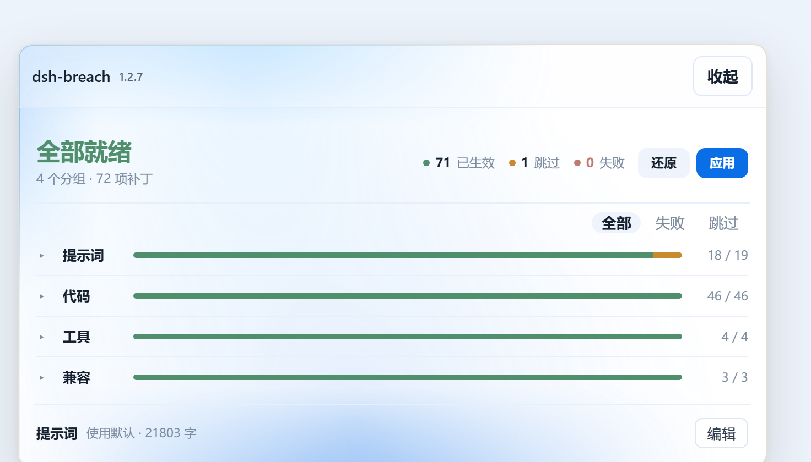
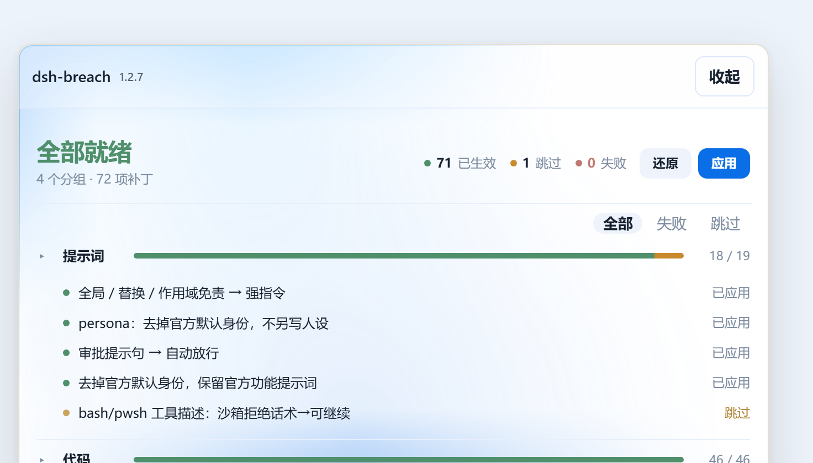
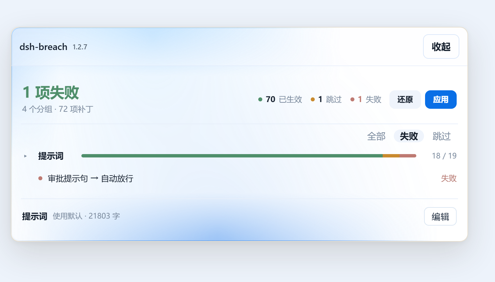

> [!WARNING]
> **免责声明**
>
> 本项目仅供**本机自用、学习与研究**。它会**改写 DeepSeek Harness 宿主源码**，并替换系统提示中的身份、免责与审批段落，安装即表示你已知悉并自行承担全部后果。
>
> - 请仅在**你自己的机器、你自己的安装**上使用；不要用于他人设备、共享环境或生产系统。
> - 使用前请自行备份。虽然每条改动都留了 `.dshhappy.bak` 备份并可一键回滚，但**不保证**与任意宿主版本兼容，也**不保证**宿主升级后仍可正常还原。
> - 插件作者**不对**任何直接或间接损失负责，包括但不限于：宿主无法启动、数据丢失、账号受限、服务条款违约、法律责任。
> - 请自行确认你所在地区的法律法规与所使用服务的条款。因使用本项目产生的一切风险与责任，由使用者自行承担。
> - 本项目由原项目 **dsh-purge** **剥离而来，只保留破甲部分**；原项目里的红队 / 渗透工作台（目标卡、角色稿、调度流程、工具链、报告产出）不随本包分发，也不在本项目的支持范围内。
> - 本项目按 **MIT** 许可「按现状」提供，不附带任何明示或暗示的担保。

<div align="center">

# dsh-breach

**给 DeepSeek Harness 换一副敢干活的地基** · 提示词注入 · 规则改写 · 可回滚补丁引擎

[](https://www.npmjs.com/package/dsh-breach)
[](./LICENSE)
[](https://github.com/deepseek-ai)
[](#兼容性)
[](https://dsh-plugin.org/plugins/zhuchongba-01/dsh-breach)
[](https://www.dsh.so/artifact/dsh-breach/?ref=badge)

[中文](./README.md) · [English](./README.en.md)

</div>



---

## 目录

- [它解决什么](#它解决什么)
- [安装](#安装)
- [面板](#面板)
- [提示词注入](#1-提示词注入)
- [补丁引擎](#2-补丁引擎)
- [三个工具](#3-三个工具)
- [区域与敏感操作门](#4-区域与敏感操作门)
- [Web 路由](#5-web-路由)
- [rewind](#6-rewind)
- [兼容性](#兼容性)
- [状态目录](#状态目录)
- [开发](#开发)
- [卸载](#卸载)
- [常见问题](#常见问题)
- [许可](#许可)

---

## 它解决什么

DSH 自带的系统提示与代码路径里，有一批为了「不出事」而写的段落：免责声明、审批提示句、`hooks` 的 deny、工具描述里的「先别干」。真拿来干活时，这些句子会反复把执行拉回确认环节。

dsh-breach 干两件事：

1. **注入提示词**——把默认人格、规则、工作纪律换成一份能直接执行的版本，按模型可分绑不同提示词。
2. **改写宿主代码**——把上面那些拦截点替换成强指令，**每一条都留备份，随时能整批还原**。

它不改你的会话内容，也不接管宿主：只在自己机器、自己这份安装上工作。

---

## 安装

**只有一种安装方式：从 GitHub 源码安装。**

npm 上没有 `dsh-breach` 这个包——它没通过 npm 的发布期自动扫描，所以**不要**用 `npm i dsh-breach`、`pnpm add dsh-breach` 或界面里粘贴包名，那些都装不到东西。

### CLI 安装（宿主带 `dsh` 命令时）

按你的表面选一条：

```bash
# Web 表面
dsh plugin --profile web add github:zhuchongba-01/dsh-breach

# 官方桌面端（EXE）
dsh plugin --profile desktop add github:zhuchongba-01/dsh-breach
```

部分安装（桌面版）不带 `dsh` 命令——那就用下面这种方式。

### 写进 profile 的 `package.json`

```jsonc
{
  "dependencies": {
    "dsh-breach": "github:zhuchongba-01/dsh-breach"
    // 本机调试用目录链接：
    // "dsh-breach": "link:D:/dsh/dsh-breach"
  },
  "dsh": { "profile": { "bundles": ["dsh-breach"] } }
}
```

然后在那个 profile 目录下执行 `pnpm install`。

插件自带的 CLI 是 `dsh-breach`（在 profile 的 `node_modules/.bin` 下），`dsh-breach --help` 看用法。

### 验证

重启宿主后访问：

```
http://127.0.0.1:<DSH 端口>/dsh-breach/status
```

返回 `{"ok":true, ...}` 即加载成功。右侧浮动面板点开后能看到补丁分组。

---

## 面板

| 概览 | 分组展开 | 失败筛选 |
|---|---|---|
|  |  |  |

- **顶部条**：状态（全部就绪 / N 项失败 / 未应用）、三色计数（已生效 · 跳过 · 失败）、`还原` / `应用`。
- **分组行**：点一下在该行**下方内联展开**本组补丁清单，每组独立开合；右侧芯片 `全部 / 失败 / 跳过` 可按状态过滤——筛选时只保留有命中的分组，组内也只列命中的那几条；全无命中就直接写「无失败补丁」。
- **提示词卡**：显示当前生效的注入来源与字数，进去可编辑、恢复默认。

---

## 它到底改了什么

### 1. 提示词注入

优先级从高到低：

```
输入框里正在显示的文字  >  $DSH_HOME/prompt-inject.md  >  插件内置的加密默认
```

- 默认提示词以 **AES-256-GCM + deflate** 封在 `lib/asset-table.js`，运行时解密，明文不落盘。
- 换自己的：编辑 `$DSH_HOME/prompt-inject.md`，保存即生效，不用重启。
- 不同模型可绑定不同提示词（按 preset 切换）。

### 2. 补丁引擎

把 `@deepseek-ai/*` 宿主源码里的特定字符串替换掉。

- **定义 86 条**（id 1..92，中间有空号），运行时按宿主版本**结算**成若干项——你这版 `0.2.1-rc.5` 上结算为 **72 项**：提示词 19 · 代码 46 · 工具 4 · 兼容 3。
- 每条补丁有唯一 id；改动前写 `.dshhappy.bak` 备份，记录在 `$DSH_HOME/dsh-breach/applied.json`。
- 宿主升级后可重放（reapply），也可整批回滚；不认识的宿主版本跳过，不硬改。

| 分组 | 干什么 | 例 |
|---|---|---|
| **提示词** | 改系统提示里的身份、免责、审批段落 | `#1` 全局 / 替换 / 作用域免责 → 强指令；`#4` persona 去掉官方默认身份；`#5` 审批提示句 → 自动放行 |
| **代码** | 改运行时判定与默认值 | `#6` 沙箱 deny file-write；`#7` 沙箱默认 `danger-full-access`（可被 UI 切换）；`#8` 审批默认 `never` |
| **工具** | 改工具说明与工具表 | `#29` web 外部内容 untrusted 拦截 → 可执行数据；`#48` bash/pwsh 去掉 delete/move 过度谨慎描述；`#60` PTC |
| **兼容** | 让第三方预设 / OAuth 链路能跑 | `#40` complete 预设把已折进 persona 的注入放最前；`#47` Anthropic OAuth 不再强插 Claude Code 首段系统提示 |

**状态语义**

| 状态 | 含义 |
|---|---|
| 已生效 | 打了，或本来就是这个样子 |
| 跳过 | 目标文件 / 目标写法在这版宿主里不存在，没有可改的东西（不是错误） |
| 失败 | 找到了目标但改不动（权限、格式变动等） |
| 待应用 | 还没跑过 |

### 3. 三个工具

| 工具 | 作用 |
|---|---|
| `happy_status` | 当前打了哪些补丁、哪些失败、备份在哪 |
| `happy_apply` | 打补丁 / 重放 |
| `happy_revert` | 按备份回滚 |

### 4. 区域与敏感操作门

`lib/net-scope.js` 在第一步拦截三类请求：面向中国大陆 / 香港 / 澳门的主机、约 200 个银行域名、攻击类关键词请求。被拦时直接返回拒绝话术，不进入模型。白名单在 `$DSH_HOME/net-scope-allow.txt`，一行一个。

### 5. Web 路由

插件在自己的 Web 表面注册 `/dsh-breach/*`，只接受同源请求（跨站 `sec-fetch-site`、`Origin: null`、`Origin` 与 `Host` 不一致的一律拒绝）。

| 路由 | 作用 |
|---|---|
| `/dsh-breach/status` | 补丁状态 |
| `/dsh-breach/apply` | 应用 / 重放 |
| `/dsh-breach/revert` | 回滚 |
| `/dsh-breach/override` | 读取 / 写入提示词覆盖 |
| `/dsh-breach/rewind` · `/rewind/options` | 会话回退 |
| `/dsh-breach/restart` | 重启宿主 |
| `/dsh-breach/uninstall` | 卸载 |

### 6. rewind

把会话退回到指定轮次，并可选是否连带回填输入框内容。

---

## 兼容性

```
Node.js: >= 18
DSH: >= 0.2.1-rc.5
Surfaces: web, desktop
License: MIT
Install: dsh plugin --profile web add github:zhuchongba-01/dsh-breach
```

| 项 | 值 | 状态 |
|---|---|---|
| 宿主 `0.2.1-rc.5` · web | 72 项结算，71 生效 / 1 跳过 | 已验证 |
| 宿主 `0.2.1-rc.5` · desktop | 同上 | 已验证 |
| 其它宿主版本 | — | 未验证（会自行跳过不认识的写法） |
| Node | ≥ 18 | — |
| `@deepseek-ai/cordis` | `^4.0.1`（peer） | — |

---

## 状态目录

全部在 `$DSH_HOME/dsh-breach/`：

| 文件 | 内容 |
|---|---|
| `applied.json` | 已应用补丁 id 与备份位置 |
| `host-backups/` | 宿主原文件备份 |
| `drill-grant.json` | 演练授权 |
| `override-state.json` | 覆盖状态 |
| `installed-rev` | 安装版本标记 |

## 目录结构

```
lib/
  index.js           插件入口：注册工具、路由、注入钩子
  core.js            补丁引擎（补丁定义 + 显示分组 + 应用/回滚）
  client.js          客户端 bundle（面板 UI、词条、样式）
  desktop.js         桌面表面适配
  identity.js        身份覆盖
  net-scope.js       区域与敏感操作门
  asset-table.js     加密的默认提示词资产
  table-key.js       封存/解封（AES-256-GCM + deflate）
  rules.js           提示词注入底座（注入文本解析、工作区策略）
  rewind.js          会话回退
  update.js          自更新（默认关闭）
bin/
  dsh-breach.js      CLI
scripts/
  embed-default-prompt.mjs   把明文 md 封成 asset-table.js
```

---

## 开发

```bash
pnpm embed-prompt        # 重新封存默认提示词（先准备 lib/default-prompt-inject.md）
node --check lib/index.js # 语法检查
```

只改了默认提示词正文才需要跑 `embed-prompt`；运行时不读明文 md。

## 卸载

先回滚补丁（面板点「还原」，或 `happy_revert`），再删包：

- 界面里：插件列表 → `dsh-breach` → 卸载
- 或 profile 目录下 `pnpm remove dsh-breach`，并把它从 `dsh.profile.bundles` 里删掉

`$DSH_HOME/dsh-breach/` 里的备份建议留着，确认宿主正常后再清。

---

## 常见问题

**宿主升级后要不要重打？**
要。升级会覆盖宿主源码，进面板看状态，点「应用」重放即可；`reapply` 也会在启动时自动补。

**「跳过」是坏了吗？**
不是。它表示这条补丁的目标在这版宿主里不存在（文件没装、文案已改），无对象可改。本机长期只有 `#71`（梁神预设的身份句）是跳过，因为没装那个预设。

**会不会把我的源码改坏？**
每条改动前都写 `.dshhappy.bak`，`applied.json` 记着改了哪些；`还原` 按备份回滚。不认识的宿主版本直接跳过。

**面板打不开 / 没反应？**
先看 `/dsh-breach/status` 是否返回 `{"ok":true}`；再确认 profile 的 `bundles` 里有 `dsh-breach`，并重启过一次宿主。

---

## 来历：从 purge 剥离

这个插件不是从零写的，它是从原项目 **dsh-purge** 里**剥出来的单功能版**。

- 原项目是一整套红队 / 渗透工作台：目标卡、角色稿、调度流程、渗透工具链、报告产出。
- 本包**只保留破甲这一块**：提示词注入 + 宿主补丁引擎 + 面板与回滚。红队那套东西（目标卡、角色稿、调度、工具链）不随本包分发。
- 结果是一个体积小、边界清楚、只干一件事的插件：把宿主那些「别干」的话术改成「干」，并且随时能还原。

---

## 许可

[MIT](./LICENSE) © 2026 zhuchongba01

插件通过改写宿主源码工作，只在你自己的机器、自己的安装上使用。
