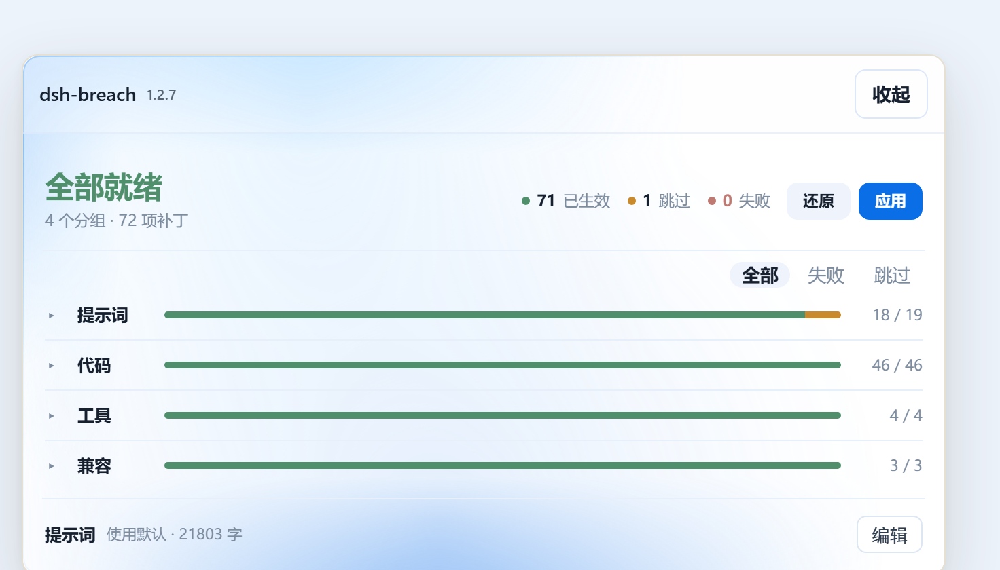
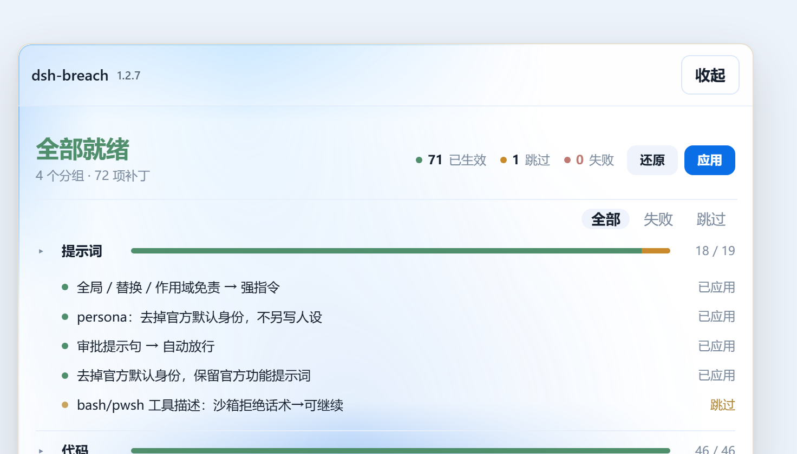
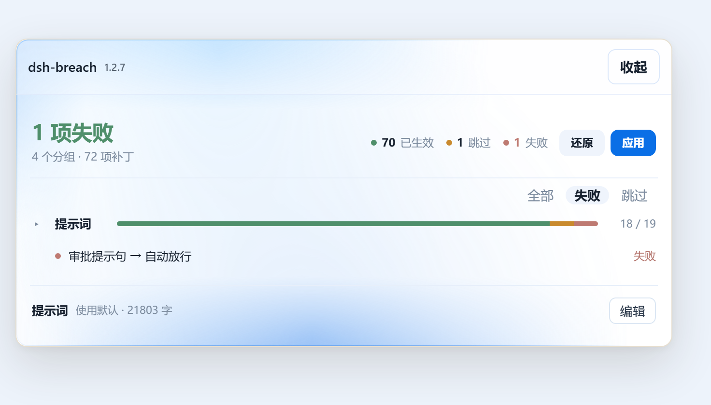

<div align="center">

# dsh-breach

**给 DeepSeek Harness 换一副敢干活的底子**
提示词注入 · 宿主规则改写 · 活体校验与一键回滚

[](https://github.com/zhuchongba-01/dsh-breach)
[](./lib/host-range.json)
[](#兼容性)
[](./LICENSE)
[](https://dsh-plugin.org/plugins/zhuchongba-01/dsh-breach)
[](https://www.dsh.so/artifact/dsh-breach/?ref=badge)

[中文](./README.md) · [English](./README.en.md) · [更新日志](./CHANGELOG.md)

</div>

> [!IMPORTANT]
> - **只能填完整 GitHub 地址安装**——npm 上同名包只是空壳占位，界面里只填 `dsh-breach` 会报「没有声明组合包」。
> - **升级顺序：先更新 DSH，再更新插件**。目前已实测验证 `0.2.1-rc.5`、`0.2.2-rc.1`、`0.2.2-rc.5`（见 [`lib/host-range.json`](./lib/host-range.json)）；遇到未验证版本只挂提示、对不上的写法自动跳过，绝不硬改宿主。

| 面板概览 | 分组内联展开 | 状态筛选 |
|---|---|---|
|  |  |  |

---

## 它解决什么问题

DeepSeek Harness（DSH）自带的系统提示词与工具链里塞了不少「防出事」的拦截：默认身份锁死、免责声明、审批提示句、`hooks` 拒绝分支、工具描述里的「谨慎别乱动」。真拿来干活时，模型动不动就停下来解释合规或反复向你讨确认。

`dsh-breach`（由原 `dsh-purge` 剥离出的纯破甲底座，不含红队工作台）只干两件事：

1. **换掉提示词**：在组装阶段把官方身份、免责与冗余记忆剥干净，原样注入你的操作提示词，保存即生效。
2. **改写宿主拦截点**：把 `@deepseek-ai/*` 源码里的沙箱默认限制、审批卡点、工具畏手畏脚描述替换掉——**每改一处先留备份，随时一键全量还原**。

---

## 安装

### 方式一：DSH 界面安装（最省事）

打开 **DSH → 插件 → 添加插件**，输入框粘贴完整仓库地址：

```text
https://github.com/zhuchongba-01/dsh-breach
```

装好后重启一次宿主，点开右上角 / 标题栏旁的 **破甲（dsh-breach）** 面板，点 **应用** 即可。

### 方式二：PowerShell 脚本一键登记（Windows 本机源码 / 调试）

不想手改配置文件可以直接跑仓库自带脚本（全只读预检 → 自动留 `.bak-install-*` 备份 → 原子写回读校验，中途出错自动回滚）：

```powershell
# 先预览计划（不写盘）
powershell -ExecutionPolicy Bypass -File install.ps1 -DryRun

# 正式登记（默认 link 模式，自动建好 node_modules 目录联接）
powershell -ExecutionPolicy Bypass -File install.ps1
```

### 方式三：手动写进 Profile 的 `package.json`

编辑 `~/.dsh/profiles/<你的profile>/package.json`：

```jsonc
{
  "dependencies": {
    "dsh-breach": "github:zhuchongba-01/dsh-breach"
    // 本机源码调试可改用： "link:D:/dsh/dsh-breach"
  },
  "dsh": {
    "profile": {
      "bundles": ["dsh-breach"]
    }
  }
}
```

然后在该 profile 目录下执行 `pnpm install` 并重启 DSH。

---

## 核心功能

### 1. 提示词单一注入与工作区规则

注入优先级从高到低：

```text
面板保存 / $DSH_HOME/prompt-inject.md  >  勾选的本地工作区规则 (AGENTS.md / CLAUDE.md)  >  插件内置加密默认
```

- **内置默认加密封存**：出厂默认提示词经 `deflate + AES-256-GCM` 封装在 `lib/asset-table.js`，仓库不带明文稿；首次启动或应用时自动写入 `$DSH_HOME/prompt-inject.md`（你手改过的文件绝不覆盖）。
- **热改即生效**：直接改面板输入框或 `$DSH_HOME/prompt-inject.md`，下一轮对话立刻生效，无需重启宿主。
- **严格单一注入**：自动按换行与首尾空白归一折叠进唯一 `persona` 段，杜绝多预设并存时提示词重复塞两遍。
- **工作区基线策略**：支持 `fallback`（有注入时剥除官方基线话术）、`strict`（始终剥除）、`always`（保留），并默认剥离 `mnemon` 插件噪音消息。

### 2. 可回滚补丁引擎（活体校验 + 待适配提醒 + 启动自愈）

共定义 **86 条补丁**，运行时按当前表面（`desktop` / `web`）和本机已安装的模块动态结算：

| 分组 | 改了什么 | 典型条目 |
|---|---|---|
| **提示词层** | 系统提示里的身份、免责、审批段落 | `#1` 全局/作用域免责 → 直接执行；`#4` 剥除官方默认身份；`#5` 审批禁令句 → 全权限放行 |
| **代码层** | 运行时权限默认值与 `hooks` 拦截 | `#6` 去掉沙箱 `deny file-write`；`#7` 默认 `danger-full-access`；`#8` 审批默认 `never`；`#30/#31` `hooks` deny/ask 旁路（面板可开关） |
| **工具层** | 工具说明、超时限制与执行器卡点 | `#29` 外部网页内容不再打 untrusted 拦截；`#48` 终端工具去掉过度谨慎提示；`#60` PTC 执行器放宽 |
| **兼容层** | 第三方预设、OAuth 与桌面壳平滑衔接 | `#40` `complete` 预设保留前置注入；`#47` Anthropic OAuth 不强插 Claude Code 首段系统词；`#83/#84` 重启不弹 crash 框 |

**不会再出现「面板全绿其实没生效」：**

- **红条（活体校验）**：官方桌面版如果还没挪走 `app.asar`，补丁就算写进了 `resources/app`，当前进程读的仍是旧包——面板会直接亮红条提示 **「彻底退出并换包」**。
- **黄条（锚点待适配）**：DSH 升级改了某处源码写法时，对不上的必选补丁进「待适配」挂黄条提醒，不阻断其余已命中的补丁生效。
- **启动自愈**：只要你点过一次「应用」，后续遇到宿主升级、退回密封 `asar` 或补丁标记丢失，下次启动会自动重打并提示重启；同一状态二次启动不重复打扰。

### 3. 会话回退（Rewind）与请求自动重试

- **无损回退**：支持撤回**上一步**（`once`）或**上一整轮含子代理**（`round`），自动基于分叉点切出干净上下文，并把刚发出的那句话填回输入框，重发时重新走最新注入。
- **自动重试**：遇到非永久性网络/网关错误自动重试（默认最多 3 次，且重试轮强制保持完整提示词注入）。

### 4. 区域与敏感目标门禁

`lib/net-scope.js` 在 `agent/pre-step` 第一步做前置过滤：当检测到攻击意图且目标命中中国大陆/港澳域名后缀或约 200 个金融/银行主域时，直接返回拒绝话术，不进模型。你自己的授权测试机可写入 `$DSH_HOME/net-scope-allow.txt`（一行一个域名或 IP）放行。

---

## 命令、工具与接口速查

| 入口类型 | 名称 | 说明 |
|---|---|---|
| **斜杠命令** | `/happy status \| apply \| revert \| edit \| uninstall \| help` | 对话框内直接查状态、打补丁、回滚、打开编辑器改提示词或卸载 |
| **斜杠命令** | `/rewind [once \| round]` | 撤回上一步或上一整轮对话，原话自动回填输入框 |
| **Agent 工具** | `happy_status` / `happy_apply` / `happy_revert` | 供模型按需自查补丁状态、执行应用或回滚 |
| **命令行 CLI** | `dsh-breach --status \| --apply \| --revert \| --edit \| --uninstall` | Profile `node_modules/.bin` 下的独立终端工具 |
| **同源路由** | `/dsh-breach/status` · `/apply` · `/revert` · `/override` · `/rewind` · `/restart` · `/uninstall` | 仅接受同源请求（拦截跨站 `Origin` 与跨站表单 `POST`） |

---

## 兼容性

- **运行环境**：Node.js `>= 18` · `@deepseek-ai/cordis` `^4.0.1` · 支持 `desktop` 与 `web` 双表面
- **已验证宿主**：`0.2.1-rc.5`、`0.2.2-rc.1`、`0.2.2-rc.5`（维护在 [`lib/host-range.json`](./lib/host-range.json)）

<!-- compat:begin -->
| 项 | 值 | 状态 |
|---|---|---|
| 宿主 `0.2.2-rc.5` · web | 81 项结算，69 生效 / 1 跳过 · 5 项本机不适用 | 已验证 |
> 由 `node scripts/gen-compat.mjs` 生成，别手改数字。
<!-- compat:end -->

---

## 目录结构与状态文件

```text
dsh-breach/
├── client.js                 # 前端面板 bundle（概览、分组筛选、提示词编辑、回退与更新弹窗）
├── cordis.patch.yml          # Cordis 组合包配置与默认开关
├── install.ps1 / uninstall.ps1 # Windows 一键登记 / 卸载脚本（带预检与事务回滚）
├── bin/dsh-breach.js         # CLI 入口
├── lib/
│   ├── index.js              # 插件主入口：生命周期、注入钩子、斜杠命令、工具与 HTTP 路由
│   ├── core.js               # 补丁引擎（86 条定义、分组结算、asar 解包衔接、备份与还原）
│   ├── identity.js           # 系统提示词清洗与单一 persona 折叠注入
│   ├── desktop.js / web.js   # 桌面端（asar 换包 / 无弹窗重启）与 Web 端适配
│   ├── reapply.js            # 版本戳校验与启动自愈重放
│   ├── rules.js              # 提示词解析链与工作区 AGENTS.md / CLAUDE.md 规则管理
│   ├── rewind.js             # 会话分叉回退与草稿回填
│   ├── net-scope.js          # 区域与金融域名敏感操作门禁
│   ├── asset-table.js        # 加密后的默认提示词槽（由 table-key.js / table-read.js 加解密）
│   └── host-range.json       # 已验证宿主版本表
├── scripts/                  # 默认提示词重封存与 README 兼容表生成脚本
└── tests/                    # 自动化回归测试套件（node:test）
```

运行期产生的状态与备份统一存放在 `$DSH_HOME/dsh-breach/`（不污染插件目录）：

| 路径 | 用途 |
|---|---|
| `applied.json` | 最近一次应用的版本、活体状态（`live`）、标记计数、宿主版本与待适配数 |
| `host-backups/` · `shim-backups/` | 宿主原文件与 CLI 启动器的原始备份 |
| `override-state.json` | 区分 `$DSH_HOME/prompt-inject.md` 是出厂种子还是用户自定义稿 |
| `hooks-deny.json` · `workspace-policy.json` | `hooks` 拒绝旁路开关与工作区基线策略配置 |
| `logs/desktop.log` | 内部诊断日志（超过 2 MB 自动轮转 `.1`，不污染宿主 `stderr`） |

---

## 开发与卸载

### 本地开发

```bash
npm test                  # 运行自动化回归测试（node --test）
npm run embed-prompt      # 修改本机 lib/default-prompt-inject.md 后重新加密生成 lib/asset-table.js
npm run gen-compat        # 根据本机安装的宿主刷新 README 兼容统计块
```

### 卸载

建议**先在面板点「还原」**（或执行 `/happy revert` / `dsh-breach --revert`）把宿主源码恢复原状，再移除插件：

- **界面卸载**：DSH → 插件列表 → `dsh-breach` → 卸载（或面板内执行卸载，会自动先还原补丁再清理登记）。
- **脚本卸载**：`powershell -ExecutionPolicy Bypass -File uninstall.ps1`（默认保留 `.dsh\dsh-breach` 备份目录，加 `-RemoveData` 一并删除）。

---

## 常见问题

**Q：宿主升级后需要重新点「应用」吗？**
如果之前已经应用过，启动自愈会自动帮你重打并提示重启；如果是桌面密封包（`app.asar` 被新安装包重新盖回），按面板顶部的红条点一次「彻底退出并换包」即可。

**Q：面板里有补丁显示「跳过」是坏了吗？**
不是。跳过代表该补丁针对的可选预设或旧版写法在你当前这版宿主里不存在，无需改动；只有真正改动失败才会计入红色的「失败」，必选补丁源码变动则会挂黄条「待适配」。

**Q：改提示词要不要重新打补丁或重启 DSH？**
不用。提示词走运行期内存组装钩子，面板里点保存或直接改 `$DSH_HOME/prompt-inject.md`，下一条消息立即生效。

---

## 免责声明与许可

> [!WARNING]
> 本项目仅供**本机自用、学习与安全研究**。插件通过改写本机 DeepSeek Harness 宿主源码并替换系统提示词工作，安装与使用即表示你已知悉并自行承担全部后果：
> - 请仅在**你自己的设备与你自己的安装副本**上使用，切勿用于他人设备、共享环境或生产系统。
> - 虽每次修改均留有备份并支持一键还原，但不保证与未来任意宿主版本兼容；操作前请自行做好重要数据备份。
> - 作者不对因使用本项目导致的任何直接或间接损失（包括但不限于宿主无法启动、数据丢失、账号受限、违反服务条款或法律责任）承担责任。请遵守所在地区法律法规与所接入模型服务的条款。

[MIT](./LICENSE) © 2026 zhuchongba01
